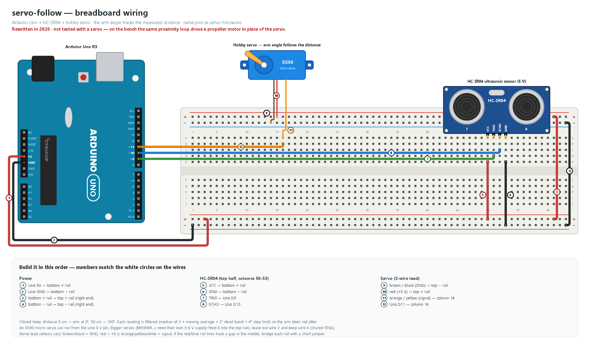

# arduino-servo-follow

An Arduino Uno sketch: an HC-SR04 ultrasonic sensor measures how far your hand is, and a hobby servo arm points
to that distance and follows it. The wiring diagram is numbered: each wire carries a white numbered circle, and
the list under the drawing tells you what to plug where, in that order. A Wokwi file lets you run it in the
browser without any hardware.

> **Honest status:** Rewritten in 2026 · not tested with a servo — on the bench the same proximity loop drove a
> propeller motor in place of the servo (according to the owner).

<!-- MEDIA PLACEHOLDER: add media/servo_follow.gif when a clip exists -->

### Behaviour (what the sketch does)

The measured distance is mapped to the servo angle: **5 cm → 0°, 50 cm → 180°**, linear in between.
Raw ultrasonic readings are noisy, so each one goes through four small steps:

1. **median of the last 3 pings** – removes single spikes and missed echoes
2. **exponential moving average** (α = 0.35) – removes jitter
3. **2° dead band** – the servo is not re-commanded for tiny changes
4. **4° step limit per update** – no violent jumps

If nothing is seen for 1.5 s, the arm slowly returns to 90°.

### Wiring



| Uno pin | Goes to | Note |
|---|---|---|
| 5V | breadboard + rails | sensor + micro servo |
| GND | breadboard − rails | common ground |
| D9 | HC-SR04 TRIG | |
| D10 | HC-SR04 ECHO | |
| D11 | servo signal (orange / yellow) | any pin works with the Servo library |

An SG90 micro servo can run from the Uno 5 V pin. Bigger servos (MG996R and similar) can pull more than 1 A
and reset the Uno: give them their own 5–6 V supply and connect only the grounds together.

### Parts (BOM)

| Qty | Part | Note |
|---|---|---|
| 1 | Arduino Uno R3 (or compatible) + USB cable | |
| 1 | HC-SR04 ultrasonic sensor | |
| 1 | SG90 micro servo (or similar) | 3-wire lead |
| 1 | Breadboard (830 points) + jumper wires | |

## Run it in the browser (Wokwi)

1. Open [wokwi.com](https://wokwi.com) → **New project** → **Arduino Uno**.
2. Replace the content of `sketch.ino` with [`servo-follow.ino`](servo-follow/servo-follow.ino).
3. Open the `diagram.json` tab and replace it with [`servo-follow/diagram.json`](servo-follow/diagram.json).
4. Add a `libraries.txt` tab with the content of [`servo-follow/libraries.txt`](servo-follow/libraries.txt).
5. Press **Start**, click the HC-SR04 in the simulation and drag the distance slider. Watch the Serial Monitor.

## Flash a real Uno

**Arduino IDE:** open the `.ino` file (the folder name must match the sketch name, it already does) →
*Tools → Board → Arduino Uno* → choose the port → **Upload** → open the Serial Monitor at **9600 baud**.


**arduino-cli:**

```bash
arduino-cli core install arduino:avr
arduino-cli lib install Servo
arduino-cli compile -b arduino:avr:uno servo-follow
arduino-cli upload  -b arduino:avr:uno -p COM3 servo-follow   # use your port, e.g. /dev/ttyACM0
```

Serial output looks like this:

```text
median_cm=18.2 filtered_cm=18.9 target_deg=56 servo_deg=56 tracking
```

## Learning notes

- **Timing with `millis()`.** The loop never calls `delay()`, so the sensor is read and the servo is moved
  on every pass instead of waiting between steps.
- **Servo + Timer1:** the Servo library uses Timer1, which disables `analogWrite()` on D9/D10. In servo-follow
  those pins are used only as plain digital TRIG/ECHO pins, so it does not matter.

## Diagrams

All wiring images are generated from code with a small drawing kit, [`tools/wiring_kit.py`](tools/wiring_kit.py)
(Uno R3, breadboard, parts, numbered wires, the build-order list). `docs/draw_wiring.py` places the parts
and wires; pin numbers are taken from the sketch.

```bash
python servo-follow/docs/draw_wiring.py      # -> wiring.svg
python tools/render_png.py                   # every docs/*.svg -> .png (headless Edge or Chrome)
python tools/check_pins.py                   # diagram pins vs. sketch pins + README links; exit 1 on a mismatch
```

Other small Arduino Uno builds by the same author:

- [arduino-proximity-alert](https://github.com/alpserkanmerkit/arduino-proximity-alert): HC-SR04 distance zones with three LEDs, ending in a propeller fan
- [arduino-plant-waterer](https://github.com/alpserkanmerkit/arduino-plant-waterer): "Super Fulffy": a soil-moisture sensor and a servo that waters a plant

## License

[MIT](LICENSE) © 2026 Alp Serkan Merkit
